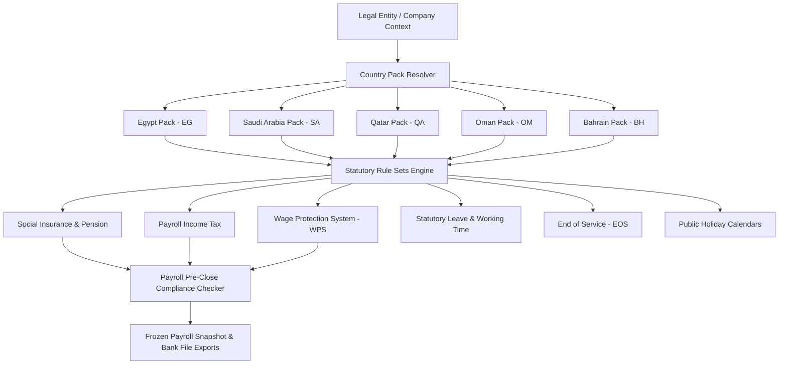

# MADARX ENTERPRISE WORKFORCE PLATFORM
# COUNTRY PACK ARCHITECTURE SPECIFICATION (PROMPT 34)

## 1. Architectural Principles
MadarX implements a **Single Platform, Multi-Country Architecture** for:
- 🇪🇬 **Egypt (EG)**
- 🇸🇦 **Saudi Arabia (SA)**
- 🇶🇦 **Qatar (QA)**
- 🇴🇲 **Oman (OM)**
- 🇧🇭 **Bahrain (BH)**

### Core Tenets:
1. **No Timeless Constants**: All statutory rates, thresholds, and caps are effective-dated and versioned.
2. **Authoritative Legal Sources**: Every rule is tied to an official ministry, social insurance organization, tax authority, or central bank decree.
3. **Historical Immutability**: Closed and finalized payroll periods are frozen. Regulatory updates never rewrite past financial snapshots.
4. **Server-Side Rule Resolution**: The authoritative country pack resolves from the legal entity and employment record, never from client-side browser hints.
5. **Decimal Financial Precision**: Monetary calculations utilize PostgreSQL `NUMERIC` and pure decimal math, strictly avoiding floating-point roundoff issues.

---

## 2. Component Layering

---

## 3. Country Specifications Summary

| Feature | Egypt (EG) | Saudi Arabia (SA) | Qatar (QA) | Oman (OM) | Bahrain (BH) |
| :--- | :--- | :--- | :--- | :--- | :--- |
| **Currency** | EGP | SAR | QAR | OMR | BHD |
| **Social Insurance Authority** | NOSI (Law 148/2019) | GOSI (Royal Decree M/33) | GRSIA (Law 1/2022) | SPF (Royal Decree 52/2023) | SIO (Law 24/1976 & 14/2022) |
| **Employee Contribution** | 11% + 0.05% Martyrs | 9.75% (9% + 0.75% SANED) | 7% (Qatari) | 8% (Omani) | 8% (Bahraini) / 1% (Expat) |
| **Employer Contribution** | 18.75% + 1% Emergency | 11.75% (Saudi) / 2% (Expat) | 14% (Qatari) | 14% (Omani) / 1% (Expat) | 16% (Bahraini) / 3% (Expat) |
| **Insurable Wage Bounds** | Min 2,000 / Max 12,600 | Min 1,500 / Max 45,000 | Min 1,000 / Uncapped | Min 100 / Max 3,000 OMR | Min 100 / Max 4,000 BHD |
| **Personal Payroll Tax** | Progressive (0% - 27.5%) | 0% | 0% | 0% | 0% |
| **Personal Tax Exemption** | 20,000 EGP / year | N/A | N/A | N/A | N/A |
| **WPS Standard** | CBE Payroll Cards | Mudad / SAMA WPS | QCB SIF Layout | CBO Electronic Format | LMRA / CBB WPS |
| **Working Hours** | 8 hrs/day, 48 hrs/week | 8 hrs/day, 48 hrs/week (36 Ramadan) | 8 hrs/day, 48 hrs/week (36 Ramadan) | 8 hrs/day, 40 hrs/week | 8 hrs/day, 48 hrs/week (36 Ramadan) |
| **Max Probation** | 3 months | 90 days (ext. 180 days) | 6 months | 3 months | 3 months |
| **Standard Notice** | 60 days (<10y) / 90 days | 60 days (monthly indefinite) | 30 days (<=2y) / 60 days | 30 days | 30 days |
| **End of Service Basis** | 0.5 mo (1-5y) / 1 mo (5y+) | 0.5 mo (1-5y) / 1 mo (5y+) | Min 3 weeks wage / year | 1 full month wage / year | 0.5 mo (1-3y) / 1 mo (3y+) |
